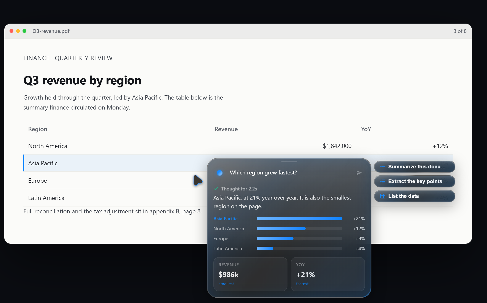

<p align="center">
  
</p>

<h1 align="center">Spirit</h1>

<p align="center">
  <strong>The AI that lives where you're looking.</strong><br />
  Hold a key. Ask about anything on screen. Get the answer at your cursor.
</p>

<p align="center">
  <a href="LICENSE"></a>
  
  
  
</p>

Spirit is a desktop AI companion that works from the screen in front of you. There is no chat window to open and no screenshot to paste. Hold the trigger, ask, and Spirit reads the screenshot, the text you selected, the clipboard, the foreground app, and the active browser tab. It answers in place. It can point at the part it means. With your approval, it can also click, type, scroll, open files, run a search, or save the result.

Most assistants wait for you to describe your context. Spirit starts with it.

<p align="center">
  
  <br />
  <sub>Interface preview. The prompt opens beside the cursor, reads the document behind it, and answers in place.</sub>
</p>

## Why Spirit

Chat assistants are good at answering questions. They are bad at knowing what you mean when "this" is sitting on your screen.

Spirit closes that gap. The cursor is the context. If you are looking at a button, a chart, a stack trace, a contract clause, or a broken layout, that is what Spirit sees. You do not translate the screen into words first.

## What it feels like

Hold `Right Ctrl` on Windows or Linux, or `Right Cmd` on macOS, for about 200 ms. A small pill opens next to the pointer.

Ask "Why is this failing?" while looking at a stack trace. Spirit reads the visible code, the terminal output, and the app around it, then streams the likely cause and the next command to try.

Ask "What is wrong with this layout?" during a design review. Spirit points at the crowded header, the weak contrast, and the misaligned grid, drawing boxes and arrows on the live screen.

Ask "Fill this in" on a form. Spirit proposes the values, shows every action it wants to take, and waits for approval before touching anything.

## Features

**Cursor-first overlay.** The pill opens on the display under your pointer, not the display where the app was launched. Hold the trigger again while the box is open to drag a region screenshot.

**Screen context, not just a screenshot.** Spirit combines a screenshot, Tesseract OCR, the accessibility tree, clipboard text, the current selection, the foreground app, and the active browser tab. Windows uses UIA. macOS uses the accessibility APIs. Linux falls back to OCR and native input.

**Pointing and tours.** The model can place `[POINT]`, `[BOX]`, and `[ARROW]` annotations. Spirit turns them into a fly-to cursor, persistent boxes, arrows, and numbered chips, so an explanation about a UI lands on the UI.

**Hands, with a brake.** Spirit can click, double-click, right-click, drag, scroll, type, press shortcuts, launch apps, read and write files, search the web, and save answers as Markdown or HTML. Every tool call goes through the approval flow. You see the target and the arguments before it runs.

**Memory that survives the session.** A local BM25 memory store recalls earlier takeaways, with synonym and fuzzy matching for near misses. Sessions persist to a workspace folder you choose. `/history` lists them. `/lastsession` restores one.

**Voice in, voice out.** Hold the trigger and speak. Local transcription uses a bundled faster-whisper sidecar. Cloud transcription falls back to Gemini, OpenAI, or OpenRouter. Replies can be read aloud with Edge neural voices.

**Bring your own model.** OpenRouter, Anthropic, OpenAI, Gemini, and any OpenAI-compatible local server work through the provider chain. If one provider fails, Spirit can fall through to the next. Local models keep the loop on your machine.

**Ghost mode.** `Ctrl+Shift+G` on Windows and Linux, or `Cmd+Shift+G` on macOS, hides Spirit from screen capture on Windows and macOS, and hides the tray and taskbar presence. Linux has no capture-exclusion API, so ghost mode only hides the tray there.

**No telemetry.** There is no analytics pipeline, no Spirit-hosted backend, and no account. API keys live in the OS keyring through Electron `safeStorage`. Requests go only to the provider you configure.

## How it works

1. Hold the trigger for 200 ms.
2. Ask in the pill. Add a region screenshot by holding the trigger again and dragging.
3. Spirit gathers the screen, selection, clipboard, app, and tab context.
4. The answer streams back into the pill. Approve any tool action it proposes.

A session stays warm for about two minutes. Ask a follow-up without losing the screenshot or the conversation.

## Install

Check [Releases](https://github.com/BibaPutt/Spirit-Ai-Cursor/releases) for a build. The current snapshot does not include a signed Windows installer yet, so a source build is the path today.

### Requirements

- Node.js 18 or newer
- npm
- Tesseract 5 for OCR (optional, but recommended)
- Python 3.9 or newer for local Whisper (optional; cloud STT works without it)
- A provider API key, or a local OpenAI-compatible server

### Run from source

```bash
git clone https://github.com/BibaPutt/Spirit-Ai-Cursor.git
cd Spirit-Ai-Cursor
npm install
npm run dev
```

The first `npm install` also builds native modules and sets up the local Whisper sidecar. It can take a few minutes.

On Windows you can also double-click `Launch-Spirit.bat`. On macOS and Linux, run:

```bash
./launch-spirit.sh
```

On macOS, grant Accessibility and Screen Recording when prompted. Windows needs no extra permission for the overlay, though some apps still block synthetic input.

## Configure a model

Open Settings from the tray menu. Paste a provider key, enable the provider, and ask. Spirit stores keys in the OS keyring, not in a `.env` file.

OpenRouter is the quickest start if you want one key for several models. For a fully local loop, point the Local AI provider at Ollama, LM Studio, vLLM, or any OpenAI-compatible endpoint.

## Platform support

| Platform | Status | Notes |
| --- | --- | --- |
| Windows 10/11 | Primary | NSIS installer, UIA, native input, vendored cua-driver |
| macOS | Source build | DMG/ZIP, Accessibility permission, CoreGraphics input |
| Linux X11 | Source build | AppImage, OCR plus xdotool fallback; Wayland support varies by compositor |

## Build

```bash
npm run typecheck
npm test
npm run build
```

Package installers:

```bash
npm run dist:win
npm run dist:mac
npm run dist:linux
```

Output lands in `release/`. Signing and notarization are env-gated. No certificate is committed.

## Architecture

Spirit is an Electron app with a strict split between the main process and the renderer.

- `electron/` owns the OS: global input hooks, screenshots, OCR, accessibility, providers, tools, voice, memory, and storage.
- `renderer/` owns the overlay: React 18, Vite, Tailwind, framer-motion.
- The renderer never gets Node access. Everything crosses a typed preload bridge.
- Provider calls are plain HTTPS and SSE clients, with fallback, retry, and circuit-breaker behavior.
- Tool calls are planned, shown for approval, and executed through an input engine that can use the vendored cua-driver or the native OS path.

Read the subsystem docs in [`docs/`](docs/README.md).

## Project layout

```text
electron/      Main process: input, capture, LLM, tools, voice, memory, storage
renderer/      Overlay UI: React, Vite, Tailwind, framer-motion
tests/         Vitest suite
docs/          Architecture and subsystem notes
resources/     Vendored cua-driver and bundled prompt skills
scripts/       Installers, OmniParser sidecar, prompt generation
site/          Marketing site and docs site
```

## Security

Spirit runs with desktop permissions because that is what the job requires. The safety model is simple: context stays local until a request, keys stay in the OS keyring, and every action that changes your computer needs approval.

To report a vulnerability, open a private security advisory instead of a public issue: https://github.com/BibaPutt/Spirit-Ai-Cursor/security/advisories/new

## Status

Spirit is alpha software. Windows gets the most testing. macOS and Linux build from source, and some integrations depend on the desktop environment. Expect rough edges, and file them.

## Contributing

Bug reports, provider fixes, and platform testing are all useful.

Before opening a pull request, run:

```bash
npm run gate
```

Keep changes focused. Do not commit keys, `.env` files, certificates, or generated build output. If you add a provider, update the router, the settings schema, and the provider docs together.

## License

Spirit is source-available under the Business Source License 1.1. The portions derived from aipointer remain MIT. See [`LICENSE`](LICENSE) for the exact split.

Third-party notices are in [`THIRD-PARTY-NOTICES.md`](THIRD-PARTY-NOTICES.md). Credits are in [`CREDITS.md`](CREDITS.md).

<p align="center">
  Built by Arshdeep Singh (Bibaputt), Siddhesh Gadekar, and Vansh Jindam.<br />
  If Spirit saves you a few clicks, star the repo.
</p>
